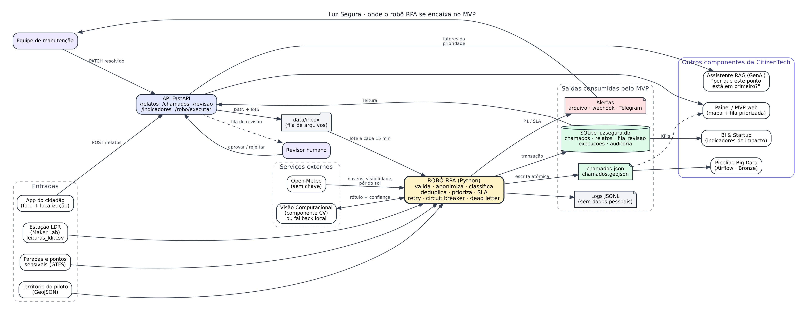
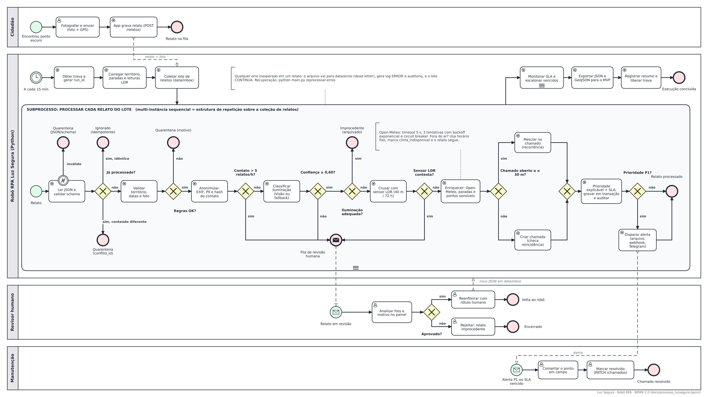

# Luz Segura · Robô RPA de triagem de relatos de iluminação

> **FIAP · Global Solution 2026.2 · CitizenTech · Engenharia de Software 4º ano**
> Disciplina: **Robotic Process Automation** · Atividade: *Do Processo Manual à Automação Inteligente*
> Componente do MVP: **Automação**

O cidadão fotografa um ponto escuro (parada de ônibus, rua, praça) e envia pelo app. Este robô transforma esse relato bruto em um **chamado de manutenção validado, sem duplicidade, priorizado de forma explicável e com prazo (SLA)**, sem ninguém precisar abrir planilha, conferir mapa ou ligar para confirmar.

---

## Ficha Técnica do MVP

| Campo | Luz Segura |
|---|---|
| **Nome do produto** | Luz Segura |
| **Cidadão e território** | Quem depende de transporte público e anda a pé à noite (trabalhadores de turno, estudantes do noturno, idosos) no Centro de Osasco/SP (piloto) |
| **Problema, em uma frase** | Pontos escuros em vias e paradas aumentam o risco e a insegurança, e o poder público demora a saber e a priorizar. |
| **Proposta de valor** | Relatos com foto, validados por IA e por sensor, viram chamados priorizados e um painel para a manutenção. |
| **Arquitetura (componentes)** | App web, API, banco, pipeline de dados, serviço de visão, assistente RAG, **automação de chamados (este repositório)**, estação com sensor LDR |
| **Fontes de dados** | Open-Meteo (sem chave), paradas no padrão GTFS, leituras do sensor LDR, relatos de teste (simulados e documentados) |
| **Modelos de IA** | LLM local com RAG; classificador de imagens noturnas; classificador das leituras do LDR |
| **URL do MVP e repositório** | MVP: `<URL_DO_MVP>` · Este repositório: `<URL_DO_REPOSITORIO>` |
| **Indicadores de impacto** | Tempo médio entre relato e conserto, pontos críticos resolvidos, queda de relatos repetidos, cobertura de pontos medidos |
| **ODS** | 11 (principal), 9 e 10 |

## Integrantes

| Nome completo | RM |
|---|---|
| Arthur Bessa Pian | RM99215 |
| Davi Desenzi | RM550849 |
| Fabrício Gutierrez Saavedra | RM97631 |
| João Victor | RM551410 |
| Márcio Gastaldi | RM98811 |

**Vídeo (até 3 min):** `<LINK_DO_VIDEO>` · **Relatório técnico (PDF):** entregue no Teams

---

## 1. O problema operacional que o robô resolve

**Antes (AS-IS, manual):** um atendente recebe a reclamação (156, e-mail, rede social), tenta achar o local no mapa, procura se já existe chamado aberto para aquele poste, decide a urgência "no olho", digita o chamado e, quando lembra, cobra o prazo. Estimamos **~6 minutos por relato**, com duplicidade, localização ruim e nenhuma regra explícita de prioridade.

**Depois (TO-BE, automatizado):** a cada 15 minutos o robô pega o lote de relatos, valida, anonimiza, classifica, cruza com o sensor e com o clima, junta relatos do mesmo poste, calcula a prioridade com justificativa, grava no banco, alerta a equipe se for crítico e escalona o que venceu o prazo. **Pessoas só entram onde o julgamento humano importa** (fila de revisão).

Detalhes no [PDD (Process Definition Document)](docs/PDD.md).

## 2. Arquitetura



## 3. Fluxo do processo (BPMN 2.0)



- Arquivo editável: [`docs/processo_luzsegura.bpmn`](docs/processo_luzsegura.bpmn) (abre no [demo.bpmn.io](https://demo.bpmn.io), Camunda Modeler ou Bizagi)
- A **estrutura de repetição** é o subprocesso multi-instância sequencial (≡): *para cada relato do lote*. O monitor de SLA também repete sobre a coleção de chamados ativos.
- Cada losango é uma **regra de decisão** implementada em [`src/luzsegura_rpa/robo.py`](src/luzsegura_rpa/robo.py) e coberta por teste.

## 4. Regras de negócio

### Decisões (gateways)

| # | Decisão | Se sim | Se não |
|---|---|---|---|
| 1 | JSON e schema válidos? | segue | quarentena `json_invalido` / `schema_invalido` |
| 2 | Relato já processado? | idêntico: ignora (idempotência) · diferente: quarentena `conflito_id` | segue |
| 3 | Território, datas e foto válidos? | segue | quarentena com motivo (`fora_do_territorio`, `data_futura`, `relato_expirado`, `foto_ausente`, `foto_corrompida`, `foto_muito_grande`, `formato_foto_nao_suportado`) |
| 4 | Mesmo contato enviou > 5 relatos em 1 h? | revisão humana `suspeita_abuso` | segue |
| 5 | Confiança da visão ≥ 0,60? | segue | revisão humana `baixa_confianca_visao` |
| 6 | Foto mostra iluminação adequada? | improcedente (arquivado com motivo) | segue |
| 7 | Sensor LDR (até 40 m / 72 h, leitura noturna) contesta? | revisão humana `conflito_sensor_ldr` | segue (confirmado soma pontos) |
| 8 | Existe chamado aberto a ≤ 30 m? | mescla (recorrência) | cria chamado (checa reincidência) |
| 9 | Prioridade P1? | alerta imediato | segue |
| 10 | SLA vencido? (monitor) | status `atrasado`, +10 pontos e alerta | mantém |

### Prioridade explicável (0 a 100)

| Fator | Pontos | Fonte |
|---|---|---|
| Foto sem iluminação / iluminação fraca | +40 / +25 | Visão Computacional |
| Sensor LDR confirmou baixa luminosidade (< 15 lux) | +15 | Maker Lab |
| Parada a ≤ 50 m / ≤ 150 m (× peso do fluxo: alto 1,0 · médio 0,7 · baixo 0,4) | até +15 / +8 | GTFS |
| Próximo (≤ 100 m) de escola, UBS, estação ou praça | +10 | pontos de referência |
| Recorrência: +5 por relato extra (máx. +15) | até +15 | deduplicação |
| Noite encoberta (≥ 80 % nuvens) ou visibilidade < 5 km | +5 | Open-Meteo |
| Reincidência: ponto consertado nos últimos 30 dias voltou a falhar | +10 | histórico |
| SLA vencido | +10 | monitor de SLA |

**Faixas e SLA:** P1 ≥ 70 (24 h) · P2 ≥ 50 (72 h) · P3 ≥ 30 (7 dias) · P4 < 30 (15 dias).
Cada chamado guarda os fatores com descrição em português (`motivo_prioridade`), o que permite ao painel e ao assistente RAG responder *"por que este ponto está em primeiro?"* com a regra exata. Todos os limiares são configuráveis no `.env`.

## 5. Exceções e resiliência (nenhuma falha silenciosa)

| Situação | O que o robô faz |
|---|---|
| Arquivo inválido, ausente, corrompido, fora das regras | Move para `data/quarentena/<motivo>/` + ficha `.motivo.json`, log WARNING, auditoria. O lote continua. |
| Erro inesperado em um relato | Move para `data/erros/` (dead letter) + ficha `.erro.json`, log ERROR. O lote continua. `python main.py reprocessar-erros` devolve para a fila. |
| Open-Meteo / API de Visão fora do ar | Timeout de 5 s, 3 tentativas com backoff exponencial + jitter, **circuit breaker** abre após 3 falhas seguidas. Fallback: horário fixo (clima) ou heurística de luminância (visão). O chamado sai marcado `clima_indisponivel`. |
| Duplicado exato (app reenviou) | Ignorado por idempotência (hash do conteúdo). Nunca gera dois chamados. |
| Mesmo id com conteúdo diferente | Quarentena `conflito_id` (possível adulteração). |
| Linhas inválidas no CSV do sensor | Descartadas e contadas no resumo; o restante é usado. |
| Webhook/Telegram fora | Alerta continua garantido em `data/saida/alertas.jsonl`; log WARNING. |
| Território ausente/ inválido | Execução marcada `falhou`, **nenhum relato é perdido** (ficam na caixa de entrada). |
| Duas execuções ao mesmo tempo | Trava de execução (`data/.robo.lock`) bloqueia a segunda; trava antiga (> 30 min) é removida. |
| Falha de banco no meio de um relato | Transação: grava tudo ou nada (rollback) e o relato vai para a dead letter. |

## 6. Logs e auditoria

- `logs/luzsegura_robo.jsonl`: uma linha JSON por evento, com `momento`, `nivel`, `run_id`, `etapa`, `relato_id`/`chamado_id`, `resultado`, `motivo`. Rotação a cada 5 MB.
- `logs/execucoes/<run_id>.json`: resumo de cada execução (lidos, criados, mesclados, improcedentes, revisão, quarentena, duplicados, erros, alertas, SLA, duração, motivos).
- Tabela `auditoria` no banco: trilha por relato e por chamado (consultável em `GET /chamados/{id}`).
- **Sem dados pessoais:** um filtro mascara e-mail, telefone, CPF e placa antes de qualquer gravação de log.
- Amostras reais de uma execução: [`logs/amostras/`](logs/amostras/).

## 7. Integração com o MVP

O resultado é consumido de **três formas** (o enunciado pede pelo menos uma):

| Via | Quem consome | Onde |
|---|---|---|
| **API REST** (FastAPI) | App/painel web, assistente RAG | `GET /chamados`, `GET /chamados/{id}`, `GET /indicadores`, `GET /revisao`, `POST /relatos`, `POST /revisao/{id}/decisao`, `PATCH /chamados/{id}/status` · documentação em `/docs` |
| **Banco de dados** | Pipeline de dados, BI | `data/luzsegura.db` (SQLite): `chamados`, `relatos`, `fila_revisao`, `execucoes`, `auditoria` |
| **Arquivos estruturados** | Airflow (camada Bronze), mapa | `data/saida/chamados.json` e `chamados.geojson` (escrita atômica, contrato versionado) |

Contrato completo e exemplos: [`docs/contrato_integracao.md`](docs/contrato_integracao.md). O painel em `http://127.0.0.1:8000` é um consumidor real dessa API (mapa, fila priorizada com "por quê?", revisão humana e histórico de execuções).

## 8. Como executar

Requisitos: Python 3.10+.

```bash
git clone <URL_DO_REPOSITORIO>
cd luz-segura-rpa
python -m venv .venv
# Windows: .venv\Scripts\activate    |    Linux/Mac: source .venv/bin/activate
pip install -r requirements.txt
cp .env.example .env          # Windows: copy .env.example .env

python main.py seed           # gera 21 cenários de teste + histórico (apaga dados anteriores)
python main.py run            # executa o robô uma vez e mostra o resumo
python main.py api            # painel em http://127.0.0.1:8000  ·  API em /docs
```

Outros comandos:

```bash
python main.py run --loop 15        # agendador simples: executa a cada 15 minutos
python main.py status               # indicadores em JSON
python main.py reprocessar-erros    # devolve a dead letter para a caixa de entrada
python -m pytest -v                 # 53 testes (sucesso, decisão, falha, LGPD, integração)
```

Testado em Linux (Python 3.13, sem internet: clima em fallback) e em Windows 11 (Python 3.14, com a Open-Meteo real).

No Windows, também dá para dar dois cliques em **`testar_no_windows.bat`**: ele cria o ambiente, instala as dependências, executa o robô, testa a API e roda os testes, salvando tudo em `teste_windows_resultado.txt`.

Em produção, o agendamento pode ser feito pelo Agendador de Tarefas do Windows, `cron` ou GitHub Actions (`schedule`) chamando `python main.py run`.

## 9. Cenários de demonstração (`python main.py seed`)

| Código | Tipo | Situação | Resultado esperado |
|---|---|---|---|
| S01 | sucesso | Poste apagado ao lado do terminal, sensor confirma | chamado P1 + alerta |
| S02 / S03 | decisão | Mais dois relatos a ~10 m do S01 | mesclados (3 relatos) |
| S04 | sucesso | Luz fraca entre a parada e a escola, sensor confirma | chamado P2 |
| S05 | decisão | Foto mostra rua bem iluminada | improcedente |
| S06 | decisão | Foto ambígua (luminância no limiar) | revisão humana |
| S07 | decisão | Foto escura, mas o sensor mediu 42 lux | revisão humana (conflito LDR) |
| S08 | falha | Relato na Praça da Sé (fora do piloto) | quarentena `fora_do_territorio` |
| S09 | falha | JSON truncado | quarentena `json_invalido` |
| S10 | falha | Foto não enviada | quarentena `foto_ausente` |
| S11 | falha | Data no futuro | quarentena `data_futura` |
| S12 | falha | Tipos errados e campos faltando | quarentena `schema_invalido` |
| S13 | sucesso | Descrição com telefone, e-mail e placa | chamado P2 com dados pessoais mascarados |
| S14 | decisão | App reenviou o S04 | ignorado (idempotência) |
| S15 | falha | Mesmo id do S05 com conteúdo alterado | quarentena `conflito_id` |
| S16 | decisão | Poste consertado há 5 dias voltou a apagar | chamado P1 (reincidência) + alerta |
| S17 | decisão | 6 relatos do mesmo contato em 25 min | 5 chamados (P4, ou P3 com noite encoberta na Open-Meteo) + 1 revisão (`suspeita_abuso`) |
| S18 | falha | `.jpg` que não é imagem | quarentena `foto_corrompida` |
| S19 | falha | Relato de 10 dias atrás | quarentena `relato_expirado` |
| S20 | decisão | Chamado antigo com SLA vencido | escalonado para `atrasado` + alerta |
| S21 | falha | Open-Meteo fora do ar | retry + circuit breaker + fallback; chamados seguem |

## 10. Testes

`python -m pytest -v` executa **53 testes** em ambiente isolado (pasta temporária, relógio fixo e Open-Meteo simulada), organizados por tipo:

| Arquivo | Tipo | O que prova |
|---|---|---|
| `tests/test_1_sucesso.py` | sucesso | relato → chamado P1 → alerta → JSON/GeoJSON; logs, resumo e auditoria |
| `tests/test_2_decisoes.py` | decisão | tabela de prioridade, dedupe, recorrência, confiança, iluminação, LDR, reincidência, SLA, anti-abuso, idempotência, revisão humana |
| `tests/test_3_falhas.py` | falha | JSON/schema/foto inválidos, path traversal, território, datas, conflito de id, API fora (retry + circuit breaker), dead letter + reprocessamento, trava |
| `tests/test_4_lgpd_seguranca.py` | LGPD | mascaramento, pseudonimização, EXIF/GPS removido, nada de PII no banco/logs/API, API exige chave |
| `tests/test_5_integracao_mvp.py` | integração | app envia pela API, robô processa, MVP lê pela API, banco e JSON |

Evidências da última execução: [`tests/evidencias/`](tests/evidencias/).

## 11. Segurança e LGPD

- **Minimização:** o contrato de entrada não tem nome nem CPF. O contato (opcional) vira **hash com salt** (detecta abuso sem guardar o dado).
- **Fotos:** EXIF/GPS do aparelho removidos, redimensionadas para ≤ 1280 px e a original é apagada da caixa de entrada. Desfoque de rostos e placas fica a cargo do componente de Visão.
- **Texto livre:** e-mail, telefone, CPF e placa mascarados antes de gravar.
- **Logs:** mesmo filtro de mascaramento; os logs não registram coordenadas, descrição nem contato do cidadão.
- **API:** leitura sem dados pessoais; escrita exige `X-API-Key`. Credenciais só no `.env` (fora do Git). Nome de foto validado contra *path traversal*.
- **IA responsável:** cada prioridade é explicada fator a fator e há **pessoa no circuito** para casos de baixa confiança, conflito com o sensor e suspeita de abuso.
- **Retenção sugerida:** quarentena 7 dias; fotos anonimizadas até 30 dias após o conserto.

## 12. Estrutura do repositório

```
├── main.py                     # ponto de entrada (CLI)
├── src/luzsegura_rpa/
│   ├── robo.py                 # orquestrador: fluxo, decisões, exceções
│   ├── regras.py               # prioridade explicável e SLA
│   ├── banco.py                # SQLite (integração com o MVP)
│   ├── api.py                  # FastAPI (integração com o MVP)
│   ├── exportacao.py           # JSON e GeoJSON
│   ├── lgpd.py                 # mascaramento, hash, EXIF
│   ├── resiliencia.py          # retry, circuit breaker, trava
│   ├── logs.py                 # logs JSONL com filtro LGPD
│   ├── geo.py                  # Haversine, território, GTFS
│   ├── modelos.py              # contrato de entrada (Pydantic)
│   ├── dados_simulados.py      # gerador dos 21 cenários
│   ├── servicos/               # Open-Meteo, Visão, sensor LDR, alertas
│   └── static/painel.html      # painel do MVP
├── data/referencia/            # território (GeoJSON) e pontos (GTFS)
├── docs/                       # PDD, BPMN (.bpmn + PNG), arquitetura, contrato, roteiro do vídeo
├── assets/                     # evidências visuais (painel, mapa, console)
├── logs/amostras/              # logs gerados (sem dados sensíveis)
├── tests/                      # testes + evidências
└── scripts/                    # geração do BPMN e das figuras
```

## 13. Dados simulados (justificativa)

Não há dados abertos de iluminação pública por ponto para Osasco no formato necessário, e o briefing permite dados simulados com geração documentada. `src/luzsegura_rpa/dados_simulados.py` gera um território hexagonal de ~1,6 km no Centro de Osasco, 12 pontos de referência no formato **GTFS `stops.txt`** (coluna `origem=simulado`), leituras do sensor e fotos noturnas sintéticas com EXIF falso. Para usar dados reais basta trocar `data/referencia/pontos_referencia.csv` por um `stops.txt` de GTFS (EMTU/SPTrans) com as colunas `tipo` e `fluxo`, e o polígono pelo limite real do bairro. O clima vem da **Open-Meteo real** quando há internet.

## 14. Limitações e próximos passos

- SQLite atende o piloto; para várias instâncias, trocar por PostgreSQL (o repositório isola o SQL em `banco.py`).
- A heurística de luminância é só plano B; a classificação oficial vem do modelo de Visão Computacional.
- Calibrar `LUX_MINIMO` e as faixas de prioridade com a equipe de manutenção e com a norma de iluminação pública vigente (ABNT NBR 5101).
- Fila em arquivos é simples e auditável; com volume maior, migrar para uma fila (RabbitMQ/SQS) mantendo o mesmo contrato.
